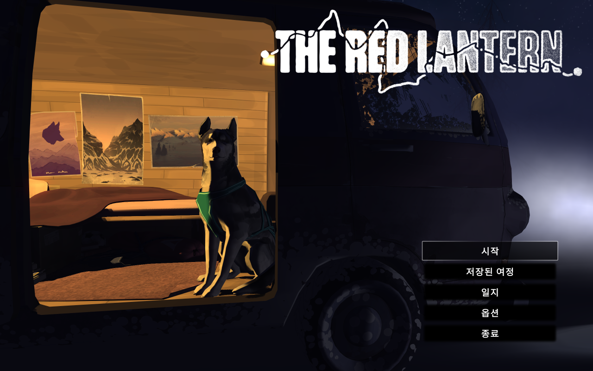

# The Red Lantern 한글패치

Timberline Studio의 [The Red Lantern](https://store.steampowered.com/app/1053710/) (Steam PC판)용 비공식 한글패치입니다.

| 타이틀 | 대사 |
| --- | --- |
|  |  |

## 번역 범위

- 게임 내 모든 대사·자막·선택지 (고유 문장 4,359개 / 항목 4,975개)
- 메뉴, 옵션, 튜토리얼, 상태 안내, 일지, 업데이트 안내문
- 음성은 영어 그대로이며 자막만 한국어로 표시됩니다.
- 이미지로 된 글자(로고 등)와 크레딧은 번역하지 않았습니다.

## 설치 방법

1. 이 저장소를 내려받습니다. (`Code` → `Download ZIP` 후 압축 해제)
2. 게임이 꺼져 있는지 확인합니다.
3. `install.bat` 을 실행하고, 게임 폴더 경로를 입력합니다.
   - 게임 폴더 위치: Steam 라이브러리에서 게임 우클릭 → 관리 → 로컬 파일 보기
   - 예: `D:\SteamLibrary\steamapps\common\The Red Lantern`
   - 게임 폴더를 `install.bat` 위에 끌어다 놓아도 됩니다.
4. 게임을 실행하면 바로 한국어로 표시됩니다. 별도로 언어를 바꿀 필요가 없습니다.

설치 스크립트는 원본 파일을 게임 폴더의 `KoreanPatch_Backup` 에 자동으로 백업합니다.

### 수동 설치

`patch` 폴더 안의 `TheRedLantern_sw_Data` 폴더를 게임 폴더에 그대로 덮어쓰면 됩니다.
바뀌는 파일은 두 개뿐입니다.

```
TheRedLantern_sw_Data/StreamingAssets/Flume/TheRedLantern_v001-Built.twig
TheRedLantern_sw_Data/StreamingAssets/aa/StandaloneWindows64/managers_and_interfaces_assets_guimanager.bundle
```

## 제거 방법

- `uninstall.bat` 을 실행하면 백업해 둔 원본으로 되돌립니다.
- 또는 Steam에서 게임 우클릭 → 속성 → 설치된 파일 → **게임 파일 무결성 확인** 을 실행하세요.

## 주의 사항

- 게임이 업데이트되면 패치 파일이 원본으로 덮어써질 수 있습니다. 그때는 다시 설치하세요.
  게임 업데이트로 파일 구조가 바뀌면 이 패치가 맞지 않을 수 있습니다. (Pack Life 업데이트 1.1.0 기준으로 제작)
- 한글패치를 적용하면 영어 텍스트가 한국어로 교체됩니다. (일본어 슬롯도 한국어로 교체)
- 세이브 파일은 건드리지 않습니다.

## 작동 원리

- 대사 데이터 `TheRedLantern_v001-Built.twig` 는 gzip으로 압축된 protobuf 형식입니다.
  각 문장의 영어(0번)·일본어(5번) 슬롯과 기본 텍스트를 한국어로 교체했습니다.
- 게임은 원래 일본어용으로 **동적 TMP 폰트**(NotoSansJP)를 사용합니다. 이 폰트의 원본 데이터를
  한글 폰트(Noto Sans KR)로 바꾸고, 영어·일본어 폰트 매핑(`LanguageFontMap`)이 모두 이 폰트를
  쓰도록 연결했습니다. 글리프는 실행 중에 필요한 만큼 자동으로 생성됩니다.

## 직접 빌드하기 / 번역 수정하기

번역문은 [`translation/ko.tsv`](translation/ko.tsv) (`id`, `en`, `ko` 탭 구분) 에 있습니다.
수정 후 아래 명령으로 `patch/` 폴더를 다시 만들 수 있습니다. **패치되지 않은 원본 게임 폴더**가 필요합니다.

```bash
pip install UnityPy
python tools/build.py "D:/SteamLibrary/steamapps/common/The Red Lantern"
```

- `%?`, `?%`, 앞뒤 공백은 빌드 시 원문에서 자동으로 붙으므로 번역문에는 넣지 않습니다.
- `<br>`, `<b>`, `<link=...>`, `[Left Stick]` 같은 태그는 그대로 유지해야 합니다.

## 용어

| 원문 | 번역 | 원문 | 번역 |
| --- | --- | --- | --- |
| Chomper | 촘퍼 | Barkley | 바클리 |
| Slayer | 슬레이어 | Gale | 게일 |
| Fin | 핀 | Stilton | 스틸턴 |
| Bodega | 보데가 | Iggy / Igloo | 이기 / 이글루 |
| Noodle | 누들 | Margot | 마고 |
| Musher | 머셔 | Mush on! | 머시 온! |
| On by! | 지나쳐! | Haw / Gee | 호(왼쪽) / 지(오른쪽) |
| Med Pack | 구급상자 | Run | 여정 |
| Energy / Hunger | 기력 / 허기 | Tired / Exhausted | 피로 / 탈진 |

## 라이선스 및 저작권

- The Red Lantern 및 게임 데이터의 저작권은 Timberline Studio에 있습니다. 이 패치는 비공식 팬 번역이며 개발사와 관련이 없습니다.
  게임을 정식으로 구매한 사용자만 사용해 주세요.
- 포함된 폰트 `fonts/NotoSansKR-Game.ttf` 는 Noto Sans KR을 수정(Regular 고정, 서브셋)한 것으로,
  [SIL Open Font License 1.1](fonts/OFL.txt) 을 따릅니다.
- 번역문과 빌드 스크립트는 자유롭게 수정·재배포할 수 있습니다.
